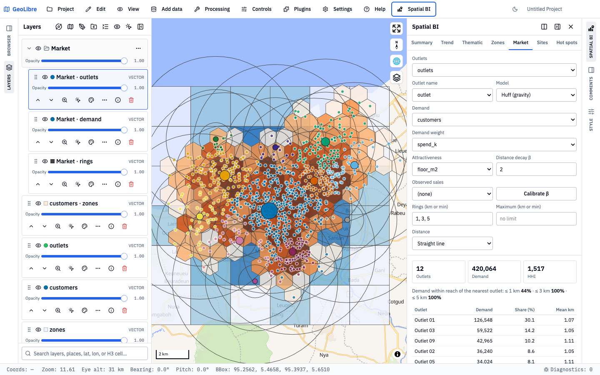
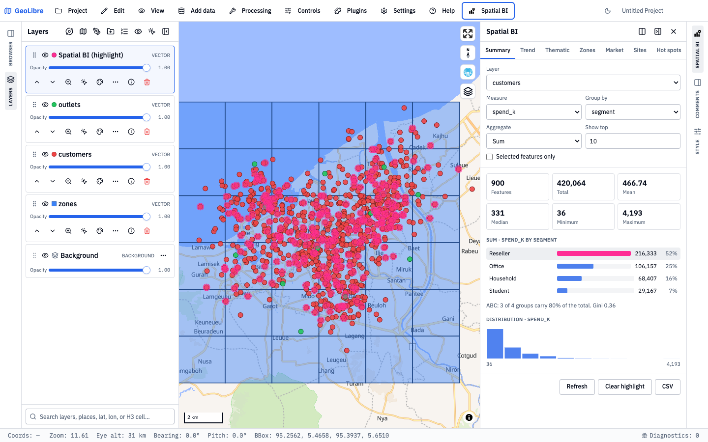
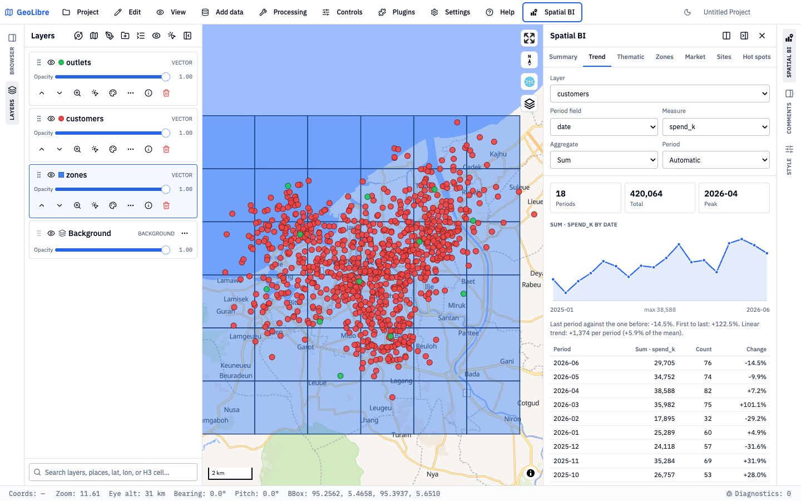
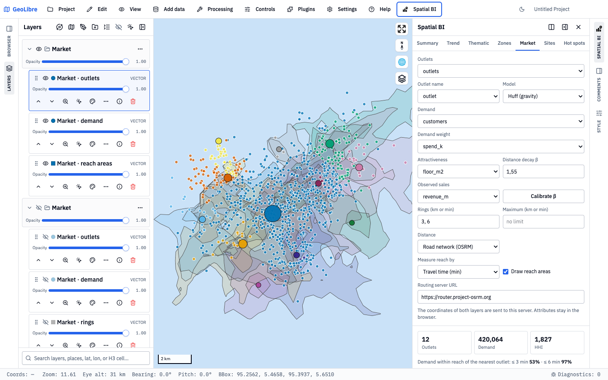
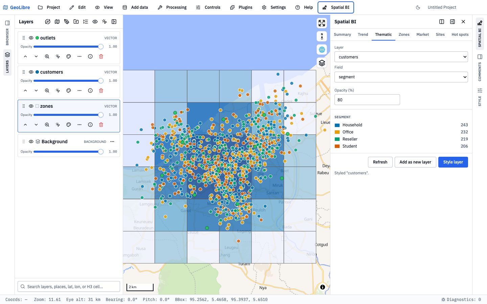
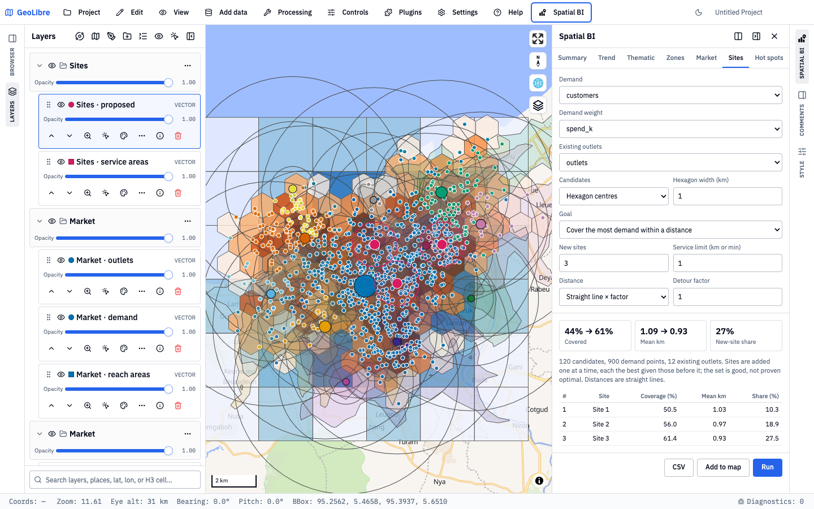
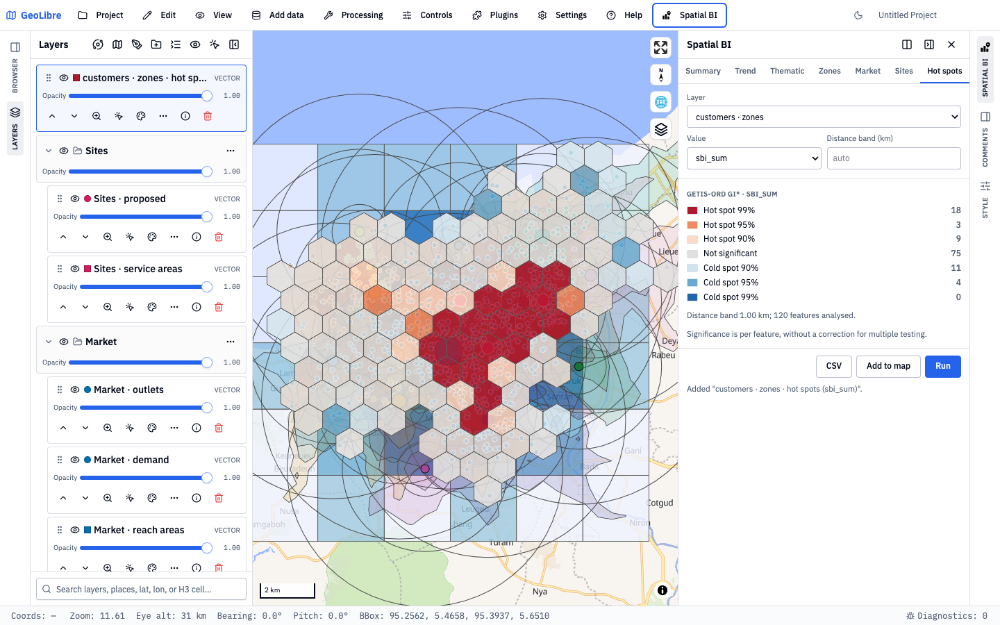

<p align="center">
  
</p>

<h1 align="center">Spatial BI — GeoLibre plugin</h1>

<p align="center">Spatial business intelligence for any vector layer in GeoLibre: numbers, thematic maps, zones, market shares and hot spots.</p>



| Summary with a highlighted group | Trend by month |
| --- | --- |
|  |  |

| Reach areas by travel time | Thematic map |
| --- | --- |
|  |  |

| Proposed new sites | Hot spots (Getis-Ord Gi*) |
| --- | --- |
|  |  |

## What it does

The panel has seven tabs. Each one reads layers already on the map and writes its results back as ordinary GeoLibre layers, styled and ready to export.

| Tab | Question it answers | Output |
| --- | --- | --- |
| **Summary** | How much, and who carries it? | KPI cards (count, total, mean, median, min, max), a ranked breakdown by any field with shares, ABC classes and Gini, a histogram. Click a bar to highlight that group on the map. CSV. |
| **Trend** | How does it move over time? | Totals per day, month, quarter or year from a date field (or any year, month or period column), with empty periods kept, change against the previous period, first-to-last change and a linear trend. CSV. |
| **Thematic** | Where is it high or low? | Graduated colours (quantiles, natural breaks, equal intervals; 2–7 classes; 7 ramps) or categorized colours, with optional proportional point sizes. Applied to the layer or to a copy. |
| **Zones** | How many, per area? | Points counted and summed inside a hexagon grid or the polygons of another layer: count, sum, mean, count per km², share. Layer + CSV. |
| **Market** | Which outlet wins which demand? | Huff gravity model or nearest-outlet allocation: expected demand and share per outlet, HHI, demand within each distance ring, mean distance. Reach measured as straight lines, straight lines times a detour factor, or road distance or travel time from an OSRM server, with reach areas drawn from the road network. The distance decay β can be calibrated against observed sales. Three layers (outlets, demand, rings or reach areas) + CSV. |
| **Sites** | Where should the next outlets open? | The best *n* locations among hexagon centres or a candidate layer, to cover the most demand within a distance, shorten the average distance, or win the largest Huff share from the existing outlets (with their own attractiveness field). Reach as straight lines with a detour factor, or road distance or travel time from an OSRM server. Proposed sites and their service areas as layers + CSV. |
| **Hot spots** | Is the pattern more than chance? | Getis-Ord Gi* z-score, p-value and confidence class per feature. Layer + CSV. |

The interface follows the GeoLibre language; English and Indonesian are included. There are no runtime dependencies and every calculation runs in the browser on the layers in memory. The panel settings are saved with the GeoLibre project; results are recomputed, not stored. The one exception to working offline is the optional road-network reach in **Market** and **Sites**: it sends the coordinates of the two layers (never their attributes) to the routing server whose address you type.

## Install

**From the zip:** build it (see [Develop](#develop)), then in GeoLibre open *Settings → Manage plugins → Settings → Install from file* and choose `spatial-bi-<version>.zip`.

**From a manifest URL** (development): run `npm run serve` and add `http://localhost:8098/plugin/plugin.json` under *Settings → Manage plugins → Settings → Manifest URLs*. Safari refuses `http://localhost` from an https page; there, install from the zip, or serve over https (`TLS_KEY=… TLS_CERT=… npm run serve`).

Then open it from *Plugins → Installed → Spatial BI*, the **Spatial BI** toolbar menu, or *Processing → Spatial BI*.

The plugin is not in the GeoLibre plugin registry yet.

## Use

Layers must be in WGS 84 (EPSG:4326), which is how GeoLibre holds GeoJSON. Polygons and lines stand in for points through their centroid wherever a tool needs a location.

1. **Summary:** pick a layer, a measure and a field to group by. Tick *Selected features only* to summarise the current selection.
2. **Thematic:** pick a field. A numeric field gives class breaks and a colour ramp; a text field gives one colour per category (the 12 largest, the rest grey).
3. **Zones:** pick the point layer, then a hexagon width or a polygon layer. Press **Run**, then **Add to map**.
4. **Market:** pick the outlet layer and the demand layer (customers, households, or zones with a population field as the weight). Press **Run**.
5. **Trend:** pick the field that holds the date or period. Dates written year first (`2025-03-14`, `2025/03`), day first (`14/03/2025`) or with a month name are recognised; a numeric column such as `year` or `month` is used as it is.
6. **Sites:** pick the demand layer and, if there are any, the existing outlets. Candidates are the centres of the hexagons that hold demand, or the features of a layer you supply (vacant lots, shortlisted addresses).
7. **Hot spots:** pick a layer of zones or hexagons and a numeric field. Leave the distance band empty to use the smallest band that gives every feature a neighbour.

The three sample layers in [`sample/`](sample/) are synthetic (`npm run sample` regenerates them); no value describes a real business or place.

## Methods

**ABC classes.** Groups are sorted by value, largest first. A group is class A while the cumulative share before it is under 80%, B while under 95%, otherwise C.

**Gini coefficient** of the group values $x_1 \le \dots \le x_n$:

$$G = \frac{2\sum_{i=1}^{n} i\,x_i}{n\sum_{i=1}^{n} x_i} - \frac{n+1}{n}$$

**Class breaks.** Quantiles use linear interpolation between order statistics. Natural breaks use the Fisher–Jenks dynamic programme (Fisher, 1958; Jenks, 1967); columns longer than 1,500 values are thinned evenly before it runs. A value belongs to the last class whose lower limit it reaches, which is also how the layer style is written.

**Distances** are great-circle (haversine) on a sphere of radius 6,371,008.8 m. Areas and the hexagon grid use an equirectangular plane centred on the data, accurate to a fraction of a percent at city or regency scale.

**Hexagons** are pointy-top; the width is the distance between opposite sides, so a cell covers $\frac{\sqrt{3}}{2}w^2$.

**Huff model** (Huff, 1963). The probability that demand point $i$ chooses outlet $j$, with attractiveness $A_j$ and distance $d_{ij}$:

$$P_{ij} = \frac{A_j^{\alpha}\, d_{ij}^{-\beta}}{\sum_k A_k^{\alpha}\, d_{ik}^{-\beta}}$$

$\alpha = 1$; $\beta$ is the distance-decay field (default 2). Distances under 50 m count as 50 m. With a maximum distance, outlets beyond it get no share, and demand out of reach of every outlet is reported, not allocated. Expected demand of outlet $j$ is $\sum_i w_i P_{ij}$. $\beta$ is an assumption until it is calibrated against observed visits or sales.

**Reach.** *Straight line × factor* multiplies every distance by a detour factor; 1.2 to 1.4 is the usual range for road networks, and it should be checked against a few real routes in the study area. *Road network* asks the OSRM table service (`/table/v1/driving/…`) for the road distance or the travel time from every demand point to every outlet, 100 coordinates per request; with travel time, the rings, the maximum and the Huff decay are all in minutes. Use your own OSRM server or one whose terms allow it; the public demo server at `router.project-osrm.org` is for light testing only.

**Rings and reach areas.** With straight-line distances a ring is a circle (shrunk by the detour factor). With the road network, *Draw reach areas* asks the server for the distance or time from each outlet to a square grid of up to 25 × 25 points around it and contours the limits with marching squares. Grid points the server has to move more than three quarters of a cell to reach a road (sea, forest) count as unreachable. The areas are approximations at the resolution the panel reports, not exact isochrones, and the grid extends one kilometre per minute of the largest limit, so a limit reached on a road faster than 60 km/h is cut at the grid edge.

**Calibrating β.** *Calibrate β* tries every β from 0.2 to 4 in steps of 0.05 and keeps the one whose Huff shares are closest (least squares) to the shares of the *Observed sales* field, reporting R². It uses the attractiveness field, reach measure and maximum currently set. A weak R² means distance and attractiveness explain little of those sales.

**Site selection** is greedy: each step adds the candidate that improves the goal most, given the outlets already there and the sites already chosen. The goals are maximal covering (Church & ReVelle, 1974), the p-median problem by greedy addition (Kuehn & Hamburger, 1963), and the Huff share won by the new sites, where existing outlets take their attractiveness from a field and a new site gets the value you type (the mean of the outlets when left empty). A greedy set is good but not proven optimal.

**Trend.** Periods with no feature are kept as zero (or as a gap for a mean). The linear trend is the least-squares slope of the value against the period index.

**HHI** is $\sum_j (100\,s_j)^2$ over the outlet shares $s_j$: 10,000 when one outlet takes everything.

**Getis-Ord Gi\*** (Ord & Getis, 1995) with binary weights inside a fixed distance band, the feature itself included:

$$G_i^* = \frac{\sum_j w_{ij}x_j - \bar{X}\sum_j w_{ij}}{S\sqrt{\dfrac{n\sum_j w_{ij}^2 - \left(\sum_j w_{ij}\right)^2}{n-1}}}$$

The classes are $|z| \ge 1.645$, $1.960$ and $2.576$ (90, 95 and 99%). Significance is per feature, without a correction for multiple testing.

## Output attributes

| Layer | Fields |
| --- | --- |
| Zones | `sbi_count`, `sbi_sum`, `sbi_mean`, `sbi_area_km2`, `sbi_count_km2`, `sbi_share_pct` (and `sbi_zone` on hexagons) |
| Market · outlets | `sbi_outlet`, `sbi_demand`, `sbi_share_pct`, `sbi_nearest_n`, `sbi_mean_km` (to the demand nearest this outlet), `sbi_in_<r>km`; `_min` in place of `_km` with travel time |
| Market · demand | `sbi_outlet` (most likely or nearest outlet), `sbi_to_outlet_km`, `sbi_nearest_km` (or `_min`), `sbi_prob` (Huff only) |
| Market · rings / reach areas | `sbi_outlet`, `limit_km` or `limit_min`, `sbi_demand` (demand within the limit) |
| Sites · proposed | `sbi_rank`, `sbi_site`, `sbi_gain` (demand newly covered), `sbi_coverage_pct`, `sbi_mean_km`, `sbi_share_pct` (each after this site is added), `lon`, `lat` |
| Hot spots | `gi_z`, `gi_p`, `gi_class`, `gi_neighbours` |

## Limits

- Hot spots: up to 5,000 features per run. Market: up to 4 million outlet–demand pairs; with the road network, up to 99 outlets and 150 requests per run, shared between the demand table (about 13,000 demand points for 12 outlets) and the reach areas (up to 7 requests per outlet). Sites: candidates × demand × new sites up to 30 million.
- Sites with the road network: demand and targets (outlets plus candidates) go to the server in blocks of 50 by 50, up to 150 requests, so about 900 demand points against 400 targets. No service-area circles are drawn for road reach.
- When GeoLibre saves a project it counts plugin settings as credential-bearing and offers to strip them; choose *Keep in file* to keep the panel settings.
- Travel times are whatever the routing server's driving profile gives: free-flow, without traffic.
- In a graduated style, features without a number are drawn in the lowest class; this is how GeoLibre's graduated renderer reads a missing value.

## Testing

| Where | Status |
| --- | --- |
| Unit tests (`npm test`) | 33 tests: geometry, statistics, class breaks, aggregation, Huff, distance matrices, β calibration, contours, trends, site selection, Gi* against a hand calculation, CSV, and a check that every panel string has Indonesian text |
| GeoLibre Web 3.8, Chrome, light and dark theme, English (16 Nov 2026) | `node tools/screenshots.mjs [light\|dark]`: every tab run end to end on the sample layers, 16 of 16 checks, no console errors |
| Firefox 125 and WebKit 17.4, the Safari engine (16 Nov 2026) | The same 16 checks through Playwright 1.44 (`ENGINE=firefox\|webkit`); WebKit over https |
| Road network (16 Nov 2026) | Travel times, reach areas and site selection run against the public OSRM demo server with the sample layers (`OSRM_URL=…`), 18 of 18 checks |
| Indonesian (16 Nov 2026) | Every tab opened and run with GeoLibre in Indonesian |
| Install from the zip (16 Nov 2026) | Installed through *Install from file*, listed, activated and opened |
| Project save and reopen (16 Nov 2026) | Settings of two tabs saved in a `.geolibre` file and restored after reopening it |
| GeoLibre Desktop, Safari itself | Not tested; Desktop on macOS draws with the same WebKit engine tested above |

GeoLibre 3.8 has one quirk the plugin works around: after a project is loaded, the host reports the panel as open while it stays folded on its rail, so *Open Spatial BI* presses the rail's expand button when the panel has not appeared.

## Develop

```bash
npm install
npm test                    # node --test
npm run build               # writes plugin/ and spatial-bi-<version>.zip (+ .sha256)
npm run serve               # static server with CORS on http://localhost:8098
node tools/screenshots.mjs  # end-to-end run in GeoLibre Web; needs the server and Google Chrome
npx @biomejs/biome lint src tools test build.mjs
```

`src/core.js` holds the geometry and statistics and touches no DOM; `src/main.js` is the panel; `src/i18n.js` the Indonesian text; `src/style.css` uses GeoLibre's design tokens. The version lives only in `plugin.json`; the build injects it. GeoLibre refuses to reload a plugin whose files changed under the same version, so bump `version` for every build you install.

## References

Church, R., & ReVelle, C. (1974). The maximal covering location problem. *Papers of the Regional Science Association, 32*(1), 101–118.

Fisher, W. D. (1958). On grouping for maximum homogeneity. *Journal of the American Statistical Association, 53*(284), 789–798.

Huff, D. L. (1963). A probabilistic analysis of shopping center trade areas. *Land Economics, 39*(1), 81–90.

Jenks, G. F. (1967). The data model concept in statistical mapping. *International Yearbook of Cartography, 7*, 186–190.

Kuehn, A. A., & Hamburger, M. J. (1963). A heuristic program for locating warehouses. *Management Science, 9*(4), 643–666.

Ord, J. K., & Getis, A. (1995). Local spatial autocorrelation statistics: Distributional issues and an application. *Geographical Analysis, 27*(4), 286–306.

Colour ramps are from ColorBrewer (Brewer, C. A., colorbrewer2.org, Apache License 2.0) and viridis (van der Walt & Smith, CC0). Category colours follow Okabe & Ito (2008).

## License

[MIT](LICENSE) © 2026 Ego Ibnu Wijaksena. The methods belong to the works cited above; this plugin only implements them.
